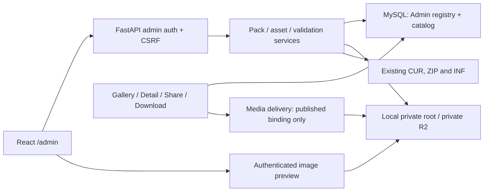

# ADMIN_SPEC.md — Kiến trúc và API Admin v1

**A01 · Đề xuất chờ chủ dự án phê duyệt · 2026-11-18**

**CR-20261120-01 · Hợp đồng hiện hành:** Admin nhận đủ 17 vai trò trong
[ARCHITECTURE.md](ARCHITECTURE.md#cr-20261120-01--windows-cursor-roles).
Gán tài sản, trả chi tiết, kiểm tra và xuất bản đều sử dụng tập 17 vai trò.
Các đoạn mô tả 8 vai trò và 15 vị trí bên dưới ghi lại phạm vi ban đầu.

Phạm vi theo [ADMIN_EXTENSION.md](ADMIN_EXTENSION.md). Admin nội bộ tạo bộ tĩnh 8 role, lưu nháp, xem trước, kiểm tra, xuất bản và thu hồi. ANI là tùy chọn có cổng nghiệm thu riêng. Kế hoạch thực thi nằm trong [ADMIN_TASKS.md](ADMIN_TASKS.md).

## 1. Điểm tích hợp đã đối chiếu với repository

| Hiện trạng | Thiết kế Admin |
|---|---|
| `app/main.py` mount router catalog và studio. `catalog.py` sở hữu prefix `/api/v1`, `studio.py` sở hữu `/api/v1/studio`. | Router Admin dùng prefix đầy đủ `/api/v1/admin` đúng một lần khi mount. Dùng `db/session.py:get_db` và transaction theo request. |
| Alembic có head `0001_initial`. Dev seed khởi tạo bốn bảng legacy. | Revision Admin là revision kế tiếp. Chạy Alembic tường minh cả trên dev Admin. Seed public vẫn vận hành riêng. |
| `CursorPack.thumbnail_url` và hai URL của `CursorItem` là NOT NULL. DB có unique theo slug và cặp pack/role, hotspot 0–47. | Giữ DDL và DTO legacy. Lưu binding riêng. Khi xuất bản, chiếu binding thành URL và cập nhật items trong cùng transaction. |
| `storage.py` chỉ có `read_asset` và `public_url`. Local giới hạn dưới `/static/samples`, R2 đọc một bucket cố định từ prefix CDN cấu hình. | A06 bổ sung lưu/đọc/xóa theo key nội bộ và đường phân phối có kiểm tra trạng thái. Giữ đường đọc URL legacy và kiểm tra prefix hiện tại. |
| `share_service.py:_resolve` lọc published, validate prefix và yêu cầu preview kết thúc `.png`. | Decode ảnh WebP/PNG và chuẩn hóa preview thành PNG. URL published dùng đúng prefix cấu hình, không có query ký. |
| `encode_cur`, `inspect_cur_header`, `build_pack_zip` và `build_install_inf` đã có. Packager có kiểm tra cấu trúc CUR/ANI. | Dùng lại encoder và ZIP/INF. A06 kiểm tra upload sâu hơn, đặc biệt ANI frame/preview cần gate riêng. |
| `InteractiveSandbox.tsx`, `HotspotGridPicker.tsx` đã tồn tại. | A13–A14 kết hợp lại qua DTO Admin và ảnh đọc có xác thực. Giữ 8 vùng, fallback CSS và theme Sandbox độc lập. |



## 2. Xác thực và phân quyền

- Một quyền Admin nội bộ. Nhiều tài khoản active cùng quản lý pack thuộc module. `require_admin` kiểm tra session, tài khoản active và expiry cho mọi route bảo vệ, gồm đọc asset. Router công khai và điều hướng hiện tại giữ luồng riêng. Route guard chỉ phục vụ UX.
- CLI chạy nội bộ, chuẩn hóa username ASCII chữ thường, 3–100 ký tự theo `[a-z0-9][a-z0-9._-]{2,99}`. Nhập password từ prompt không echo hoặc secret qua stdin, 15–128 ký tự và tối đa 512 byte UTF-8, không trim/normalize password. CLI từ chối username trùng. Vận hành reset/disable qua CLI được kiểm soát, thu hồi mọi session của tài khoản cùng transaction và audit. Không có public signup hoặc tài khoản mặc định.
- Argon2id PHC với salt ngẫu nhiên do thư viện sinh, đề xuất 64 MiB, t=3, p=1. Benchmark trên container, bounded threadpool và giới hạn số phép băm đồng thời theo memory budget. Dummy hash cùng thông số khi user không tồn tại. Sai mật khẩu/unknown/disabled cùng mã và nội dung 401. Rehash khi login hợp lệ và thông số đã đổi. Không log dữ liệu xác thực.
- Session opaque ngẫu nhiên 256 bit, base64url không padding. DB giữ SHA-256 của token. Cấp token mới sau login thành công, thu hồi session cũ nếu request đang có session hợp lệ. TTL tuyệt đối 8 giờ, idle 30 phút, cập nhật last_seen theo cửa sổ tối đa 1 phút và kiểm tra expiry mỗi request. Không có refresh endpoint. Logout thu hồi server-side và xóa cookie đúng Path, hết hạn phải login lại. Job nội bộ dọn session hết hạn/revoked sau 7 ngày.
- Cookie `__Secure-ccs_admin`: HttpOnly, Secure, SameSite=Lax, Path=/api/v1/admin, host-only, Max-Age=28800. Dev ưu tiên HTTPS same-origin. Cho phép cookie dev tên riêng thiếu Secure chỉ với cấu hình explicit và loopback HTTP. Không dùng `__Host-` với path hẹp.
- CSRF cho mọi mutation đã xác thực, kể cả validate và multipart. Token per-session suy ra bằng HMAC-SHA256 trên session token với khóa riêng do deploy cấp, hash token CSRF lưu DB. Login và `me` trả token để client giữ trong memory. Server so sánh constant time. Đổi khóa CSRF kèm revoke session toàn bộ. Cookie session chỉ xuất hiện trong Set-Cookie. Kiểm tra Origin chính xác, fallback scheme/host/port từ Referer nếu thiếu Origin, fail closed nếu cả hai thiếu hoặc Origin null. Login chưa có session áp dụng Origin/Referer và chỉ nhận JSON, từ chối simple form. Giới hạn body và kiểm tra auth/CSRF trước parsing multipart.
- Production dùng một origin cho Admin React và Admin API, routing qua reverse proxy. Public Pages có thể phục vụ Gallery ở topology riêng. Không mở CORS credentialed cho Admin v1. Nếu topology đổi, cần ACR với allowlist cụ thể, preflight và test cookie. Tin proxy headers từ proxy đã cấu hình, kiểm tra Host và HTTPS production. Các response Admin dùng no-store và nosniff. Log, trace, error và frontend storage loại credentials và nội dung upload.
- Đề xuất giới hạn cửa sổ 15 phút: login 20 lần/IP và 10 lần/account, tính cả username không tồn tại. Upload 20 yêu cầu/phút/Admin, mutation khác 60/phút/Admin, validate/publish 5/phút/pack. Trả 429 kèm Retry-After. Dùng counter nguyên tử dùng chung trong MySQL, TTL theo cửa sổ, khóa account từ HMAC username chuẩn hóa, giới hạn key cardinality bằng IP gate và cleanup. Proxy có thể bổ sung giới hạn toàn cục. Giới hạn concurrency cho hashing, decode và ZIP riêng.

## 3. Đề xuất schema MySQL và migration

Các bảng dưới đây dùng InnoDB, UTC DATETIME(6), BIGINT UNSIGNED cho ID số/FK, tên constraint/index rõ ràng theo `0001_initial`. ID asset UUID lưu BINARY(16), biểu diễn string UUID chuẩn qua API. Tất cả trường bắt buộc trừ trường ghi nullable.

| Bảng | Cột, khóa và ràng buộc |
|---|---|
| `admin_users` | id PK auto increment, username VARCHAR(100) ASCII binary UNIQUE, password_hash VARCHAR(255), is_active BOOLEAN default true, created_at, updated_at. |
| `admin_sessions` | id PK auto increment, admin_user_id FK CASCADE, token_hash BINARY(32) UNIQUE, csrf_token_hash BINARY(32), expires_at, revoked_at nullable, created_at, last_seen_at khởi tạo khi login. Index expiry và (admin_user_id, expires_at). |
| `admin_pack_state` | pack_id PK/FK tới cursor_packs RESTRICT, revision BIGINT UNSIGNED default 1, thumbnail_asset_id nullable. Hàng tồn tại đánh dấu pack do Admin quản lý. |
| `admin_assets` | id PK, pack_id FK tới admin_pack_state RESTRICT, kind ENUM(preview,thumbnail,cursor), storage_key VARCHAR(255) ASCII binary UNIQUE, mime_type VARCHAR(64), byte_size INT UNSIGNED, sha256 BINARY(32), width/height SMALLINT UNSIGNED, hotspot_x/y nullable chỉ cho thumbnail/preview, created_by_admin_id FK RESTRICT, created_at. UNIQUE (pack_id,id) cho FK cùng pack, index (pack_id,created_at). |
| `admin_pack_roles` | pack_id FK tới admin_pack_state RESTRICT, role_type dùng cùng ENUM với CursorRole, asset_id và preview_asset_id là FK composite cùng pack, hotspot_x/y TINYINT UNSIGNED CHECK 0–47. PK (pack_id, role_type). |
| `admin_audit_events` | id PK auto increment, actor_admin_id nullable cho failed login, FK SET NULL, action VARCHAR(48), target_type VARCHAR(32), target_id nullable VARCHAR(64), outcome VARCHAR(24), request_id VARCHAR(64), created_at. Index (created_at,id), (target_type,target_id,created_at). |
| `admin_rate_limits` | scope VARCHAR(32), subject_hash BINARY(32), window_start DATETIME(6), counter INT UNSIGNED, expires_at DATETIME(6), PK (scope,subject_hash,window_start), index expires_at. |

Thumbnail binding có FK composite (pack_id,thumbnail_asset_id) → admin_assets(pack_id,id), cài sau khi tạo hai bảng để xử lý vòng FK. Kind và hotspot đúng kích thước kiểm tra ở service. Audit bắt buộc cho login, logout, bootstrap/reset/disable, create/edit, upload, gán role, publish/unpublish và tác vụ cleanup. Success audit cho thay đổi DB nằm cùng transaction. Failure audit ghi riêng, giới hạn lượng ghi khi bị throttle. Giữ audit 90 ngày theo giá trị đề xuất, không ghi request body, filename do user gửi, raw IP, token hoặc file bytes.

- Draft mới dùng placeholder do server kiểm soát trong `cursor_packs.thumbnail_url`, là URL HTTPS hợp lệ của ảnh placeholder cố định do deploy cấp. Admin trả thumbnail null khi chưa có binding. Publish luôn yêu cầu thumbnail thật. Draft assignment nằm trong bảng role Admin. Khi publish mới upsert `cursor_items` theo unique key để giữ ID.
- Upgrade từ head hiện hành, giữ nguyên dữ liệu bốn bảng cũ và không backfill binding cho seed. Downgrade thử trên DB cô lập. Sau khi đã ghi dữ liệu Admin, fail closed nếu còn pack được quản lý, cho tới khi có kế hoạch export/restore được duyệt. MySQL DDL có implicit commit, kiểm tra trạng thái từng bước trên snapshot và restore backup khi migration dở dang. Schema rollback không đồng nghĩa với rollback xuất bản.
- Pack cũ hiển thị trong Admin dạng chỉ đọc (`managed=false`). Việc đưa pack legacy vào quyền quản lý cần thiết kế import/adoption có kiểm tra provenance và bảo toàn URL, xin duyệt riêng. Bộ tạo qua Admin áp dụng toàn bộ CRUD và lifecycle.
- API chỉ dùng ID số an toàn JavaScript (1..2^53−1) và kiểm tra ở biên. A02/A05 phải xử lý bộ cấp ID chạm giới hạn rõ ràng. Timestamp trả RFC3339 UTC.

## 4. Admin API

Base `/api/v1/admin`. Tất cả route dưới đây yêu cầu session trừ login. Mọi POST/PATCH/PUT yêu cầu CSRF header trừ login, áp dụng ngoại lệ trước session ở §2. JSON từ chối field lạ, body metadata tối đa 16 KiB, login 4 KiB. Multipart có chính xác một file và một kind, metadata/overhead giới hạn 32 KiB ngoài file. Mọi content type khác hợp đồng trả 415. ID lạ hoặc asset khác pack trả 404.

| Method | Path | Input | Success |
|---|---|---|---|
| POST | /auth/login | username, password | 200 Auth + Set-Cookie |
| POST | /auth/logout | không body | 204 + clear cookie |
| GET | /auth/me | cookie | 200 Auth |
| GET | /packs | status tùy chọn, q tối đa 100, page mặc định 1, limit mặc định 12 và 1–48 | 200 Page |
| POST | /packs | Metadata | 201 Detail + ETag + Location |
| GET | /packs/{id} | cookie | 200 Detail + ETag với managed pack |
| PATCH | /packs/{id} | Metadata fields và/hoặc thumbnail_asset_id, If-Match | 200 Detail + ETag |
| POST | /packs/{id}/assets | multipart kind và file, If-Match | 201 Asset |
| GET | /packs/{id}/assets/{asset_id}/content | cookie, asset thuộc pack, kind preview/thumbnail | 200 bytes với media type chuẩn |
| PUT | /packs/{id}/roles/{role} | Assignment, If-Match | 200 Detail + ETag |
| POST | /packs/{id}/validate | không body, If-Match | 200 Report |
| POST | /packs/{id}/publish | không body, If-Match | 200 Detail + ETag |
| POST | /packs/{id}/unpublish | không body, If-Match | 200 Detail + ETag |

GET content là route Admin bổ sung cần duyệt, phục vụ ảnh private với cookie, HTTP no-store và MIME ảnh cố định. Không trả raw CUR qua route này. Phân phối media public ở §5 là transport cho URL asset, nằm ngoài bảy operation JSON/binary public hiện hữu. Không có delete endpoint trong v1. Thay asset bằng upload mới và gán lại.

### DTO và precondition

- Auth gồm admin {id,username}, csrf_token và expires_at. Page gồm items là Summary[] và pagination {page,limit,total,total_pages,has_next}. Sắp xếp created_at DESC, id DESC, lọc q trên title/slug với bind parameters.
- Metadata có title trim 1–180, slug ASCII lowercase 1–200, phân đoạn chữ thường/số nối dấu gạch ngang, category_id tồn tại, description tối đa 4000 ký tự, is_premium boolean mặc định false. is_animated chỉ nhận false nếu client gửi ở v1. Sau lần publish đầu, slug giữ cố định để bảo toàn link, nhận biết bằng sự tồn tại của projection items được giữ khi unpublish. Create đặt draft. PATCH partial phân biệt omitted và null, chỉ thumbnail_asset_id nhận null để bỏ gán. Không nhận status, counter hoặc URL.
- Summary gồm id, title, slug, category_id, description, is_premium, is_animated, status, managed, revision, created_at, updated_at. Detail thêm thumbnail (Asset hoặc null), thumbnail_url (string hoặc null), roles và assets (Asset[] của pack, theo created_at DESC rồi asset_id ASC). Role gồm role_type, asset_id, preview_asset_id, hotspot_x, hotspot_y, preview_url. Legacy trả assets rỗng. Managed=false trả revision null, roles biểu diễn legacy với asset IDs null và URL legacy, thumbnail biểu diễn qua trường nullable thumbnail_url riêng. Managed draft chỉ trả thumbnail_url qua URL Admin khi có ảnh; published managed vẫn dùng URL Admin ở DTO này.
- Giới hạn 128 asset registry/pack, kiểm tra dưới khóa trước khi commit, vượt hạn mức trả 409 ASSET_QUOTA_EXCEEDED. Asset gồm asset_id, kind, mime_type, byte_size, sha256 hex lowercase, width, height, hotspot_x/y nullable, content_url nullable. Không trả key nội bộ. Mỗi file là immutable. Upload không đổi draft revision vì chưa gán file. Upload kiểm tra precondition lại lúc ghi registry; retry có thể sinh asset chưa gán và được cleanup. Client refresh detail sau 409 hoặc timeout trước khi retry.
- ETag mạnh dạng `"pack-123-r4"`. If-Match bắt buộc với thao tác pack yêu cầu precondition, đúng một tag. Thiếu → 428, stale → 409 REVISION_CONFLICT, sai syntax → 422. Revision chỉ tăng khi nội dung/binding/status đổi. PUT/PATCH no-op trả current. Publish/unpublish đúng trạng thái đích và revision hiện tại là no-op. Retry stale không tự áp dụng thay đổi. Download counter public không đổi revision.
- Report gồm valid, pack_id, revision, missing_roles, errors và warnings. Mỗi issue có code, field, message. 200 valid=false cho lỗi dữ liệu xác định được. Publish trả 422 PACK_INVALID kèm danh sách field/reason trong details nếu không đạt. Dependency tạm thời lỗi trả 503 để phân biệt với file thiếu/hỏng.

### Mẫu JSON

Login request và response 200:

```json
{"username":"admin","password":"<supplied-secret>"}
```

```json
{"admin":{"id":1,"username":"admin"},"csrf_token":"<session-csrf>","expires_at":"2026-11-18T12:00:00Z"}
```

Tạo draft request và response 201 với `ETag: "pack-123-r1"`:

```json
{"title":"Peach Orbit","slug":"peach-orbit","category_id":2,"description":"Bộ con trỏ tông đào","is_premium":false}
```

```json
{"id":123,"title":"Peach Orbit","slug":"peach-orbit","category_id":2,"description":"Bộ con trỏ tông đào","is_premium":false,"is_animated":false,"status":"draft","managed":true,"revision":1,"created_at":"2026-11-18T05:00:00Z","updated_at":"2026-11-18T05:00:00Z","thumbnail":null,"thumbnail_url":null,"roles":[],"assets":[]}
```

PATCH thumbnail, response upload preview và PUT role request:

```json
{"thumbnail_asset_id":"d9eed2c1-de81-4cc6-949f-3e29904c1d30"}
```

```json
{"asset_id":"a26ec814-a05e-44b9-87bd-8bec08633c98","kind":"preview","mime_type":"image/png","byte_size":372,"sha256":"91aab212ce21ccebebf883c528198ab7c0fa5868f36c175e1d98b6172c65ee44","width":32,"height":32,"hotspot_x":null,"hotspot_y":null,"content_url":"/api/v1/admin/packs/123/assets/a26ec814-a05e-44b9-87bd-8bec08633c98/content"}
```

```json
{"asset_id":"95456bc6-15bc-4cb3-b39c-92647603354c","preview_asset_id":"a26ec814-a05e-44b9-87bd-8bec08633c98","hotspot_x":3,"hotspot_y":3}
```

Validate response 200 và mẫu lỗi precondition:

```json
{"valid":false,"pack_id":123,"revision":2,"missing_roles":["link","text","busy","working","precision","unavailable","move"],"errors":[{"code":"THUMBNAIL_REQUIRED","field":"thumbnail_asset_id","message":"Cần gán thumbnail."}],"warnings":[]}
```

```json
{"error":{"code":"REVISION_CONFLICT","message":"Bản nháp đã thay đổi. Hãy tải lại.","details":[{"field":"If-Match","reason":"stale revision"}],"request_id":"6f1c9c0d"}}
```

Publish/unpublish trả cùng Detail schema, status lần lượt published/draft với revision mới. Error envelope giữ `error.code/message/details/request_id` và `X-Request-ID`. Mã chính: 400 INVALID_ACTION, 401 AUTH_REQUIRED/INVALID_CREDENTIALS, 403 CSRF_FAILED/ORIGIN_DENIED, 404 NOT_FOUND, 409 SLUG_CONFLICT/PACK_LOCKED/REVISION_CONFLICT/ASSET_QUOTA_EXCEEDED, 413 PAYLOAD_TOO_LARGE, 415 UNSUPPORTED_MEDIA_TYPE, 422 VALIDATION_ERROR/PACK_INVALID, 428 PRECONDITION_REQUIRED, 429 RATE_LIMITED, 503 STORAGE_UNAVAILABLE. Details là mảng object {field,reason} theo envelope hiện hữu. PACK_INVALID chiếu các lỗi validation thành field/reason. Không trả stack, SQL hoặc secrets.

## 5. Asset và vòng đời pack

1. Tạo draft và lưu metadata. Upload nhận PNG/WebP tĩnh cho preview/thumbnail, CUR cho cursor. Giới hạn 2 MiB/file và 12 triệu pixel khi decode ảnh, reject animation, format mismatch, tệp hỏng và nội dung ngoài allowlist. Preview chuẩn RGBA PNG vuông 32 hoặc 48, thumbnail chuẩn WebP tĩnh tối đa 512×512. Decode/re-encode ảnh bỏ metadata. CUR tĩnh một entry 32/48, dùng inspector và kiểm tra đủ DIB/XOR/AND, offsets, type, dimensions, biHeight, stride, alpha/mask và hotspot. Từ chối container ngoài encoding chuẩn hiện có. Có thể chuẩn bị CUR bằng Studio hiện tại; Admin không thêm API convert riêng. ANI trả 415 trong phạm vi bắt buộc. Chỉ bật khi có parser RIFF/ACON đầy đủ, giới hạn frame/rate/geometry, preview PNG đại diện, test mapping và tải Windows được phê duyệt.
2. Ghi bằng key UUID immutable thuộc pack. Local private nằm ngoài mount StaticFiles, ghi atomically và ràng buộc root/symlink. R2 private dùng SDK fixed endpoint/bucket và quyền object tối thiểu. Hash bytes chuẩn hóa, xác nhận ghi xong trước khi commit registry. Khi DB fail sau object write, cleanup theo key; nếu cleanup fail, worker đối soát sau thời gian an toàn. Khi upload storage fail, không commit registry. Không dùng URL hoặc filename do client cấp để định vị file.
3. Gán role bằng cặp ID cùng pack đúng kind. Role canonical theo CursorRole: pointer, link, text, busy, working, precision, unavailable, move. Hotspot là integer nằm trong kích thước thực, khớp CUR header. Preview có cùng kích thước với CUR và hình/alpha tương ứng với raster CUR để Sandbox khớp Windows. Thay hotspot cần xuất CUR lại với tọa độ mới. Pack có thể nháp thiếu role. Preview Admin dùng GET content, adapter frontend chấp nhận URL cùng origin trong namespace Admin asset, chỉ bind tại 8 vùng Sandbox.
4. Validate snapshot binding/revision, kiểm metadata/category/slug, thumbnail, đủ chính xác 8 role, ownership, format, bytes/hash, hotspot, khả năng đọc asset, budget và artifact. Dùng `build_pack_zip(title, slug, urls, storage)` với adapter tin cậy ánh xạ key private từ projection, dùng `build_install_inf` và mapping 15 slot hiện tại. Không gọi HTTP download public để validate. Không tăng download_count. ZIP ở RAM, file tối đa 10 MiB, tổng 50 MiB, giới hạn job theo B08.
5. Publish chạy lại validate theo snapshot. Sau I/O, khóa pack/state bằng thứ tự nhất quán, kiểm lại revision/status và toàn bộ binding snapshot trước khi commit. Mọi metadata/binding edit, upload commit, publish/unpublish cùng khóa pack/state theo thứ tự đó để tuần tự hóa. Cleanup dùng cùng lock và kiểm tra tham chiếu trước khi xóa. Object immutable, đã xác minh trước commit. Upsert projection items/thumbnail, đổi status và ghi audit cùng transaction. Asset route public đọc binding/status đã commit, nên không cần copy object sang bucket public.
6. Media delivery giữ prefix đang dùng bởi share và storage. Dev route hẹp `/static/samples/managed/...` được đăng ký trước StaticFiles mount hiện hữu. Prod định tuyến prefix managed dưới PUBLIC_CDN_BASE_URL về gateway kiểm tra trạng thái bằng DB trước khi stream từ private R2. Catalog URL có dạng `<configured-prefix>/managed/<pack-id>/<asset-id>.png` hoặc `.cur/.webp`; storage adapter đọc key tương ứng qua SDK, không fetch URL từ mạng. Chỉ cho public GET/HEAD đối với asset đang gán và pack published, trả 404 cho draft, orphan và key sai; disable CDN caching cho managed prefix và gửi no-store. Browser asset đã tải có thể được giữ ở phía người dùng; không cam kết thu hồi bản sao. Deployment phải chứng minh route ordering, CORS của ảnh theo nhu cầu Canvas và allowlist CSP.
7. Unpublish nguyên tử chuyển draft, giữ object và binding, chặn request public mới qua gateway, giữ projection để bảo toàn ID. Sau unpublish có thể sửa, validate, republish. Nếu publish thất bại trước commit thì giữ draft. Nếu commit thành công nhưng client mất response, GET detail lấy trạng thái/revision trước khi retry. Rollback sau publish là unpublish và sửa draft rồi validate lại; v1 không có lịch sử phiên bản tự động.
8. Thu gom asset chưa gán sau 24 giờ và chỉ khi không có tham chiếu từ binding hoặc projection. Cleanup đánh dấu/xóa registry có kiểm tra dưới khóa pack, rồi xóa object; crash giữa các bước được worker đối soát lại theo key sau grace period. Giữ nguyên asset chưa khẳng định được ownership hoặc reference. Backup/restore gồm DB, object keys/bytes và kiểm tra hash, thử phục hồi trên staging trước release.

## 6. Tương thích, xung đột và kiểm thử

| Luồng hiện hữu | Kỳ vọng hồi quy |
|---|---|
| GET /categories, GET /packs | Counts và pagination chỉ tính published; filter/search/sort đúng. |
| GET /packs/{slug}, GET /packs/{id}/download | Draft 404; published giữ shape, file names, registry order và atomic download count. Hai bộ seed gốc vẫn đọc qua LocalStorage. |
| POST /studio/convert | Envelope, format, binary, hotspot và rate limits hiện hành. |
| POST /studio/share, GET /studio/share/{code} | Vẫn dùng published refs và cùng prefix .png, share cũ đọc được, nguồn đã unpublish trả 410 và mã lỗi theo hợp đồng hiện hành. |

- Xung đột storage: local hiện mount public cả cây samples, R2 adapter hiện chỉ đọc. A06/A08 phải chứng minh managed media được kiểm tra trạng thái trước khi trả bytes và không có đường truy cập trực tiếp vòng qua gateway. Ghi ACR nếu topology buộc đổi prefix hoặc hành vi public cũ.
- Xung đột OpenAPI: test T15 hiện kiểm tập route public với schema phục vụ ở dev. Đề xuất xuất schema Admin riêng nội bộ, giữ schema public và assertion public. Nếu cần đổi cách phân phối schema hiện tại, xin duyệt ACR. Kiểm tra router Admin qua app chính.
- Xung đột phạm vi: PRD gốc loại admin portal khỏi MVP public. Module mở rộng theo ADMIN_EXTENSION, release gate riêng. T23–T25 vẫn theo kế hoạch gốc. Public seed assets đã tồn tại có cơ chế phân phối riêng, quyết định adoption cần xử lý việc thu hồi URL legacy.
- Test theo [ADMIN_TASKS.md](ADMIN_TASKS.md): migration trên MySQL cô lập, auth/Origin/CSRF/revoke/expiry và shared throttle, upload sai parser/quá hạn mức/cross-pack, race publish/edit/unpublish và lỗi DB/R2, draft direct GET/HEAD, rollback/cleanup, regression T15, React browser 375/768/1440 và Windows 10/11 install smoke. Kiểm tra account enumeration và secrets trong log, stale asset cache, ảnh cross-origin, giới hạn resource, snapshot restore. Trước release cần TLS, credential/cookie policy, rate limits đa replica, backup phục hồi và sign-off §12 của ADMIN_EXTENSION.

## 7. Phê duyệt trước A02

1. Schema additive, placeholder thumbnail và asset registry/binding, pack legacy chỉ đọc trong Admin v1, nhiều tài khoản có cùng quyền.
2. Same-origin Admin, cookie Path hẹp, khóa CSRF riêng, Argon2id và TTL 8 giờ/idle 30 phút. Ngưỡng throttle, retention audit 90 ngày và grace cleanup 24 giờ là giá trị đề xuất.
3. Private media proxy có kiểm tra trạng thái theo DB, GET content Admin, CDN bypass cache và namespace managed trên prefix hiện hữu. Xác nhận topology Caddy/CDN và ngân sách truy vấn media trước A06/A08.
4. Static CUR bắt buộc, ANI gated. Quy tắc unpublish trước khi sửa, slug ổn định, rollback qua unpublish và giữ object. Hard delete và adoption legacy cần quyết định riêng.
5. Dùng `ADMIN_PROGRESS.md` làm tracker module từ A02 nếu được duyệt. Mọi thay đổi supporting files ngoài primary scope phải theo quy trình của ADMIN_EXTENSION.

A01 chờ phê duyệt các quyết định trên. A02 là bước tiếp theo sau khi có phê duyệt.
